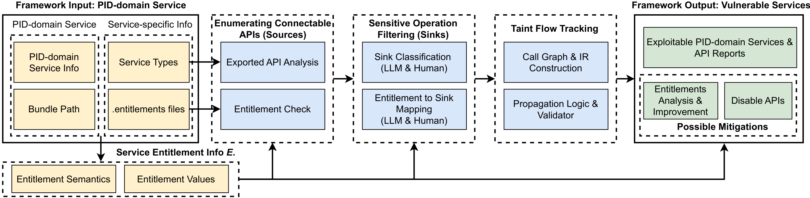

# Chekhov’s Gun: Uncovering Hidden Risks in macOS Application-Sandboxed PID-Domain Services — CCS 2025 Artifacts

This repository provides the code and supporting data for an LLM-assisted static analysis framework that discovers logical vulnerabilities in macOS PID-domain services.

The diagram below shows the framework's inputs, analysis stages, and outputs:

[](docs/architecture-overview.png)

The end-to-end pipeline consists of:

- Filtering connectable XPC services

- Enumerating exported APIs

- Constructing sensitive sinks with LLM assistance

- Mapping entitlements to sensitive sinks with LLM assistance

- Performing taint analysis on PID-domain services

## Requirement
- macOS 15.2

- IDA Pro 9.0 (headless configured per Hex-Rays docs)

- Python 3.13.4 (recommended to use a virtualenv)
    - Please follow the [IDA Pro documentation](https://docs.hex-rays.com/user-guide/idalib) to configure headless mode.  


## Step-by-step

### 1) Filter connectable XPC services
Script: Source/filterXPC.py
```
python3 filterXPC.py
```
Output: LLM4Sec/groundtruth_NSXPC/XPC_Nocheck/check.txts

### 2) Retrieve exported APIs

Script/Function: Source/idaTaintAnalysis.py → dump_exported_apis_all

Please invoke dump_exported_apis_all function, the output is stored in LLM4Sec/exportedAPI

### 3) Construct sensitive list (LLM-assisted)
Script: Source/LLMAssistant/S2_getSensitivefunctionlist_cli_version.py 

```
python3 S2_getSensitivefunctionlist_cli_version.py start_index end_index
```
start_index, end_index represents the interval of a selection function. 

Output: Source/LLMAssistant/S2_result

The S2_result is converted into S2_New_Classification. 

### 4) Map entitlement to sensitive functions. (LLM-assisted)
Script: Source/LLMAssistant/S3_result/entitlementClassification_Description.py

```
python3 entitlementClassification_Description.py
```
Output: Source/LLMAssistant/Entitlement_desc_dir

Script: Source/LLMAssistant/S3_result/entitlementMappingLLM_multient_multifunc.py
```
python3 entitlementMappingLLM_multient_multifunc.py ent_start ent_end file_path
```
ent_start, ent_end represent range of the selected ent.   
file_path is path of storing mapping result. 

Output: Source/LLMAssistant/S3_result/Entitlement_map_func_final

Note⚠️: For security reasons, data related to still-unpatched vulnerabilities has been removed. Only mappings for fixed vulnerabilities are retained for artifact evaluation.

### 5) Taint analysis
#### construct sink list for each connectable service. 
Script/Function: Source/idaTaintAnalysis.py → generateSinklistforSinglebinary  

Please invoke dump_exported_apis_all function, the output is stored in Source/LLMAssistant/S4_taint_analysis. After manually verificated and corrected as we mentioned in our paper, the final output is Source/LLMAssistant/S4_taint_analysis_filter. 

Note⚠️: Only sink lists for fixed vulnerabilities are provided.


#### program analysis

Script/Function: Source/idaTaintAnalysis.py → main

Please invoke main function. BTW. As some bugs of the headless mode, this function can't run very fast. Otherwise, the python environment will crash. To handle this, we setup a variable called line_index indicting the order of service, then we change the value from 0 to the number of service everytime. Besides, we run this script in pycharm since the debug mode it has can slow the running time. 

Note⚠️: Only analysis results for fixed vulnerabilities are provided.

Output: Source/LLM4Sec/dataflowRes
